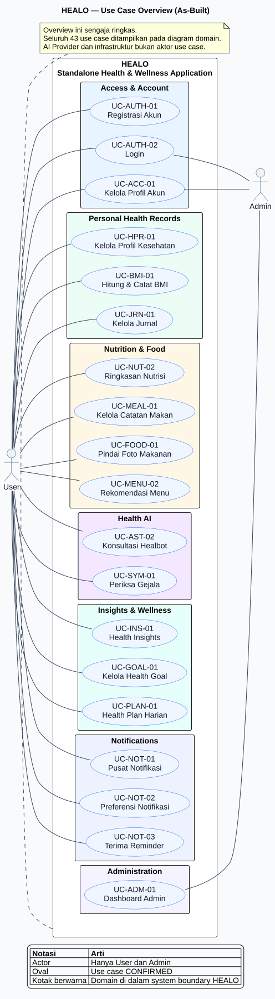

# Fase 4 — Use Case Diagrams

Fase ini menerjemahkan katalog dan deskripsi **43 use case CONFIRMED** ke diagram UML yang dapat diedit. Diagram memakai satu system boundary **HEALO**, hanya menampilkan aktor **User** dan **Admin**, dan memisahkan domain agar hubungan tetap terbaca.

## Daftar diagram

| Diagram | Cakupan | Jumlah use case katalog | Source | Render |
|---|---|---:|---|---|
| Overview | Use case utama lintas domain | Ringkasan | [PlantUML](src/00-overview.puml) | [SVG](rendered/00-overview.svg) · [PNG](rendered/00-overview.png) |
| Public, Authentication, Preferences & Account | Public, autentikasi, bahasa, dan akun | 10 | [PlantUML](src/01-public-auth-account.puml) | [SVG](rendered/01-public-auth-account.svg) · [PNG](rendered/01-public-auth-account.png) |
| Dashboard & Personal Health Records | Dashboard, profil kesehatan, BMI, dan jurnal | 7 | [PlantUML](src/02-health-records.puml) | [SVG](rendered/02-health-records.svg) · [PNG](rendered/02-health-records.png) |
| Nutrition, Meal, Food Analysis & Healthy Menu | Nutrisi, meal tracking, pemindaian makanan, dan menu sehat | 9 | [PlantUML](src/03-nutrition-food.puml) | [SVG](rendered/03-nutrition-food.svg) · [PNG](rendered/03-nutrition-food.png) |
| Healbot & Symptom Checker | Percakapan Healbot dan pemeriksaan gejala | 5 | [PlantUML](src/04-health-ai.puml) | [SVG](rendered/04-health-ai.svg) · [PNG](rendered/04-health-ai.png) |
| Insights, Goals & Daily Wellness Plan | Insight, goal, dan rencana wellness harian | 8 | [PlantUML](src/05-insights-goals-plan.puml) | [SVG](rendered/05-insights-goals-plan.svg) · [PNG](rendered/05-insights-goals-plan.png) |
| Notifications & Administration | Notifikasi dan dashboard admin | 4 | [PlantUML](src/06-notifications-admin.puml) | [SVG](rendered/06-notifications-admin.svg) · [PNG](rendered/06-notifications-admin.png) |
| **Total diagram domain** |  | **43** |  |  |

## Aturan pemodelan

- Diagram overview sengaja hanya menampilkan use case utama. Keenam diagram domain merupakan representasi lengkap katalog 43 use case.
- Association aktor–use case menggunakan garis solid tanpa arah.
- `<<include>>` hanya digunakan ketika subperilaku wajib terjadi pada alur sukses.
- `<<extend>>` hanya digunakan untuk perilaku opsional yang memiliki kondisi/guard tertulis.
- AI provider, mail transport, scheduler, queue, Reverb, storage, database, controller, dan service adalah komponen pendukung/internal; semuanya bukan aktor use case.
- Admin hanya dihubungkan ke interaksi yang memang tersedia untuk akun Admin. Role Admin tidak digambarkan memiliki bypass ke data kesehatan privat milik User.
- Use case **UC-FOOD-02** menegaskan bahwa angka hasil pemindaian harus ditinjau sebagai nilai bernama—misalnya kalori, protein, karbohidrat, dan lemak—dikoreksi bila perlu, lalu dikonfirmasi sebelum catatan makan dibuat.

## Sumber dan keterlacakan

- ID, nama, aktor, status: [Katalog Use Case Fase 2](../02-backlog-mapping/use-case-catalog.md).
- Alur dan guard: [Use Case Descriptions Fase 3](../03-use-case-descriptions/README.md).
- Evidence implementasi dan test tetap ditelusuri melalui masing-masing use case description dan backlog mapping; diagram tidak menggantikan evidence tersebut.
- Ringkasan pemeriksaan fase ini: [Validasi dan rencana Fase 5](validation-and-next-step.md).

## Informasi render

Seluruh source berhasil dirender ke SVG dan PNG pada **27 Oktober 2026** dengan PlantUML 1.2024.8, Java 8, dan layout engine Smetana. Tidak ada binary/dependency renderer yang ditambahkan ke repository.

