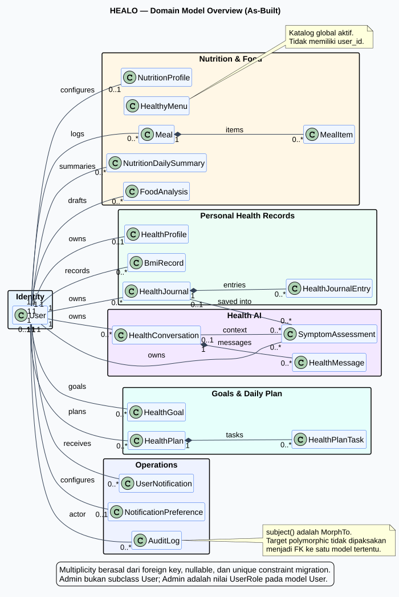

# Fase 5 — Class Diagrams

Fase ini merekonstruksi struktur class HEALO dari implementasi aktual. Diagram memisahkan **domain model** dari **application/service layer** agar multiplicity data, operasi penting, dan dependency orkestrasi tetap terbaca.

## Daftar diagram

| Diagram | Fokus | Source | Render |
|---|---|---|---|
| Domain Model Overview | Seluruh 20 model Eloquent dan relasi utamanya | [PlantUML](src/00-domain-overview.puml) | [SVG](rendered/00-domain-overview.svg) · [PNG](rendered/00-domain-overview.png) |
| Account, Health Profile, BMI & Journal | Model, service, value object, dan enum personal health records | [PlantUML](src/01-health-records.puml) | [SVG](rendered/01-health-records.svg) · [PNG](rendered/01-health-records.png) |
| Nutrition, Meal, Food Analysis & Healthy Menu | Model nutrisi, service, provider contract, serta hasil analisis berlabel | [PlantUML](src/02-nutrition-food.puml) | [SVG](rendered/02-nutrition-food.svg) · [PNG](rendered/02-nutrition-food.png) |
| Healbot & Symptom Assessment | Conversation, message, assessment, safety pipeline, dan Health AI provider | [PlantUML](src/03-health-ai.puml) | [SVG](rendered/03-health-ai.svg) · [PNG](rendered/03-health-ai.png) |
| Insights, Goals & Daily Plan | Source metrics, goal progress, plan generation, progress, dan personalisasi | [PlantUML](src/04-insights-goals-plan.puml) | [SVG](rendered/04-insights-goals-plan.svg) · [PNG](rendered/04-insights-goals-plan.png) |
| Notification, Reminder & Audit | Durable notification, preferences, queue job, broadcast event, command, dan audit | [PlantUML](src/05-notifications-audit.puml) | [SVG](rendered/05-notifications-audit.svg) · [PNG](rendered/05-notifications-audit.png) |
| Application Service & Provider Map | Inventaris visual seluruh 38 service dan dua provider contract | [PlantUML](src/06-application-service-map.puml) | [SVG](rendered/06-application-service-map.svg) · [PNG](rendered/06-application-service-map.png) |

## Cakupan implementasi yang diperiksa

| Jenis | Jumlah | Pemakaian dalam dokumentasi |
|---|---:|---|
| Model Eloquent | 20 | Seluruhnya ada pada overview dan diagram domain |
| Service | 38 | Seluruhnya ada pada service map; dependency rinci yang relevan ada pada diagram domain |
| Provider interface | 2 | Ditampilkan beserta realization Groq dan LocalDemo |
| Data/result object | 9 | Ditampilkan pada domain tempat object digunakan |
| Enum | 26 | Enum penting ditampilkan sebagai tipe atribut; daftar lengkap tetap berada di source |
| Queue job | 1 | Ditampilkan pada diagram notification |
| Broadcast event | 1 | Ditampilkan pada diagram notification |
| Console command | 2 | Ditampilkan pada diagram notification |
| Controller | 54 | Diperiksa sebagai delivery adapter, tidak digambar satu per satu |
| Policy | 16 | Diperiksa sebagai authorization boundary, tidak dianggap domain entity |
| Migration | 26 | Sumber column, nullable, foreign key, unique constraint, dan multiplicity |

Controller, Form Request, API Resource, middleware, dan policy tidak digambar satu per satu karena merupakan delivery/authorization adapter dan akan membuat class diagram domain berubah menjadi daftar file. Dependency bisnis yang mereka panggil direpresentasikan pada service layer dan sudah dapat ditelusuri lewat audit serta use case description.

## Notasi

- `[enc]`: atribut memakai encrypted cast pada model.
- `[derived]`: nilai dihitung atau disinkronkan server-side, bukan dipercaya langsung dari client.
- `1`, `0..1`, dan `0..*`: multiplicity berdasarkan foreign key, nullable, dan unique constraint migration.
- Garis composition digunakan untuk child yang siklus hidupnya terikat pada parent, seperti journal entry, meal item, message, dan plan task.
- Garis putus-putus menunjukkan dependency penggunaan, bukan foreign key.

## Keputusan struktur penting

- **Admin bukan subclass terpisah.** Admin adalah nilai `UserRole::Admin` pada model `User`.
- `HealthyMenu` adalah katalog global dan tidak memiliki `user_id`.
- `FoodAnalysis` tidak memiliki foreign key ke `Meal`. Konfirmasi melalui `FoodAnalysisService` baru membuat `Meal` dan `MealItem` setelah User meninjau label kalori, protein, karbohidrat, lemak, porsi, dan satuannya.
- `SymptomAssessment` boleh tidak memiliki conversation atau journal karena kedua foreign key tersebut nullable.
- `AuditLog::subject()` adalah relasi polymorphic; diagram tidak mengarang satu target entity tetap.
- Repository layer khusus tidak ditemukan. Service menggunakan model/query Eloquent secara langsung.

## Sumber keterlacakan

- Struktur class dan operation: `app/Models`, `app/Services`, `app/Data`, `app/Contracts`, `app/Jobs`, `app/Events`, dan `app/Console/Commands`.
- Relasi dan multiplicity: model relationship methods serta `database/migrations`.
- Provider binding dan fallback: `app/Providers/AppServiceProvider.php`.
- Delivery dan authorization cross-check: `app/Http/Controllers` dan `app/Policies`.
- Hasil pemeriksaan rinci: [Validasi dan rencana Fase 6](validation-and-next-step.md).

## Informasi render

Seluruh tujuh source berhasil dirender ke SVG dan PNG pada **27 Oktober 2026** dengan PlantUML 1.2024.8, Java 8, dan layout engine Smetana. Tidak ada binary renderer yang ditambahkan ke repository.

