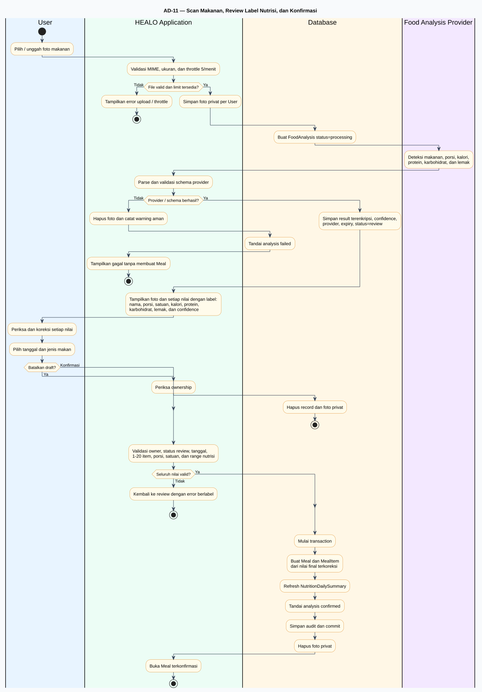

# Fase 6 — Activity Diagrams with Swimlanes

Fase ini mendokumentasikan workflow as-built HEALO sebagai **21 activity diagram PlantUML**: satu overview dan 20 workflow terpisah. Seluruh diagram menggunakan swimlane, initial node, decision dengan guard, alternative/error path, dan final node.

## Artefak utama

- [Poster/gallery seluruh activity diagram](activity-diagram-poster.html)
- [Matriks workflow ke 43 use case](workflow-use-case-matrix.md)
- [Validasi dan rencana Fase 7](validation-and-next-step.md)

## Daftar diagram

| ID | Workflow | Source | SVG | PNG |
|---|---|---|---|---|
| AD-00 | Alur keseluruhan HEALO | [PUML](src/00-overall-user-journey.puml) | [SVG](rendered/00-overall-user-journey.svg) | [PNG](rendered/00-overall-user-journey.png) |
| AD-01 | Registrasi dan verifikasi email | [PUML](src/01-registration-verification.puml) | [SVG](rendered/01-registration-verification.svg) | [PNG](rendered/01-registration-verification.png) |
| AD-02 | Login dan logout | [PUML](src/02-login-logout.puml) | [SVG](rendered/02-login-logout.svg) | [PNG](rendered/02-login-logout.png) |
| AD-03 | Reset, konfirmasi, dan ubah password | [PUML](src/03-password-recovery-change.puml) | [SVG](rendered/03-password-recovery-change.svg) | [PNG](rendered/03-password-recovery-change.png) |
| AD-04 | Profil akun, bahasa, dan penghapusan akun | [PUML](src/04-account-preferences-deletion.puml) | [SVG](rendered/04-account-preferences-deletion.svg) | [PNG](rendered/04-account-preferences-deletion.png) |
| AD-05 | Dashboard kesehatan User | [PUML](src/05-health-dashboard.puml) | [SVG](rendered/05-health-dashboard.svg) | [PNG](rendered/05-health-dashboard.png) |
| AD-06 | Profil kesehatan | [PUML](src/06-health-profile.puml) | [SVG](rendered/06-health-profile.svg) | [PNG](rendered/06-health-profile.png) |
| AD-07 | Perhitungan dan riwayat BMI | [PUML](src/07-bmi-records.puml) | [SVG](rendered/07-bmi-records.svg) | [PNG](rendered/07-bmi-records.png) |
| AD-08 | Jurnal, entry, dashboard, dan tren | [PUML](src/08-health-journal.puml) | [SVG](rendered/08-health-journal.svg) | [PNG](rendered/08-health-journal.png) |
| AD-09 | Profil, target, dan ringkasan nutrisi | [PUML](src/09-nutrition-profile-summary.puml) | [SVG](rendered/09-nutrition-profile-summary.svg) | [PNG](rendered/09-nutrition-profile-summary.png) |
| AD-10 | Catatan makan dan item nutrisi | [PUML](src/10-meal-tracking.puml) | [SVG](rendered/10-meal-tracking.svg) | [PNG](rendered/10-meal-tracking.png) |
| AD-11 | Scan, review label nutrisi, dan konfirmasi | [PUML](src/11-food-analysis-review-confirm.puml) | [SVG](rendered/11-food-analysis-review-confirm.svg) | [PNG](rendered/11-food-analysis-review-confirm.png) |
| AD-12 | Pencarian dan rekomendasi menu sehat | [PUML](src/12-healthy-menu.puml) | [SVG](rendered/12-healthy-menu.svg) | [PNG](rendered/12-healthy-menu.png) |
| AD-13 | Percakapan Healbot dan safety boundary | [PUML](src/13-healbot-conversation.puml) | [SVG](rendered/13-healbot-conversation.svg) | [PNG](rendered/13-healbot-conversation.png) |
| AD-14 | Pemeriksaan gejala dan emergency gate | [PUML](src/14-symptom-assessment.puml) | [SVG](rendered/14-symptom-assessment.svg) | [PNG](rendered/14-symptom-assessment.png) |
| AD-15 | Riwayat assessment dan simpan ke jurnal | [PUML](src/15-symptom-history-journal.puml) | [SVG](rendered/15-symptom-history-journal.svg) | [PNG](rendered/15-symptom-history-journal.png) |
| AD-16 | Health Insights, tren, dan AI insight | [PUML](src/16-health-insights.puml) | [SVG](rendered/16-health-insights.svg) | [PNG](rendered/16-health-insights.png) |
| AD-17 | Health Goal dan progress | [PUML](src/17-health-goals.puml) | [SVG](rendered/17-health-goals.svg) | [PNG](rendered/17-health-goals.png) |
| AD-18 | Health Plan, task, dan personalisasi | [PUML](src/18-daily-health-plan.puml) | [SVG](rendered/18-daily-health-plan.svg) | [PNG](rendered/18-daily-health-plan.png) |
| AD-19 | Preferensi, reminder, durable notification, dan realtime | [PUML](src/19-notification-lifecycle.puml) | [SVG](rendered/19-notification-lifecycle.svg) | [PNG](rendered/19-notification-lifecycle.png) |
| AD-20 | Dashboard Admin dan audit operasional | [PUML](src/20-admin-dashboard-audit.puml) | [SVG](rendered/20-admin-dashboard-audit.svg) | [PNG](rendered/20-admin-dashboard-audit.png) |

## Aturan swimlane

- **User** dan **Admin** adalah aktor bisnis.
- **HEALO Application**, **Database**, **Mail Transport**, **AI Provider**, serta **Scheduler / Queue / Realtime** adalah lane tanggung jawab komponen, bukan aktor tambahan pada use case diagram.
- Lane hanya ditampilkan bila berpartisipasi dalam workflow tersebut.
- Data privat selalu dibaca atau ditulis owner-scoped. Admin tidak memperoleh bypass ke konten kesehatan User.
- Provider AI berada setelah validasi/safety awal dan sebelum parsing/safety hasil. Jalur kegagalan selalu memakai error aman atau fallback yang memang diimplementasikan.

## Penegasan alur scan makanan

AD-11 tidak menampilkan angka tanpa arti. Sebelum konfirmasi, HEALO menampilkan dan mengizinkan koreksi untuk:

- nama makanan;
- ukuran porsi dan satuan;
- kalori;
- protein;
- karbohidrat;
- lemak;
- confidence estimasi.

`Meal` dan `MealItem` baru dibuat setelah semua nilai tervalidasi dan User memberikan konfirmasi eksplisit.

## Informasi render

Seluruh 21 source berhasil dirender ke SVG dan PNG pada **27 Oktober 2026** dengan PlantUML 1.2024.8 dan Java 8. Tidak ada binary renderer yang ditambahkan ke repository.

