# HEALO Database ERD

The diagram is the target schema across all phases. Migrations are added per phase so each release remains runnable.

```mermaid
erDiagram
    USERS ||--o| HEALTH_PROFILES : has
    USERS ||--o{ HEALTH_JOURNALS : owns
    HEALTH_JOURNALS ||--o{ HEALTH_JOURNAL_ENTRIES : contains
    USERS ||--o{ BMI_RECORDS : records
    USERS ||--o{ FOOD_SCANS : submits
    FOOD_SCANS ||--o{ FOOD_SCAN_ITEMS : detects
    FOODS ||--o{ FOOD_SCAN_ITEMS : matches
    USERS ||--o{ FOOD_LOGS : owns
    FOODS ||--o{ FOOD_LOGS : references
    FOOD_SCANS ||--o{ FOOD_LOGS : confirms
    USERS ||--o{ NUTRITION_RECORDS : summarizes
    MENUS ||--o{ MENU_ITEMS : contains
    FOODS ||--o{ MENU_ITEMS : uses
    USERS ||--o{ MENU_RECOMMENDATIONS : receives
    MENUS ||--o{ MENU_RECOMMENDATIONS : recommends
    USERS ||--o{ SYMPTOM_CHECKS : submits
    SYMPTOM_CHECKS ||--o| SYMPTOM_CHECK_RESULTS : yields
    USERS ||--o{ NOTIFICATIONS : receives
    USERS ||--o{ AI_USAGE_LOGS : initiates
    USERS ||--o{ AUDIT_LOGS : acts

    USERS {
      bigint id PK
      string name
      string email UK
      string password
      string role
      string locale
      timestamp email_verified_at
      timestamps timestamps
      timestamp deleted_at
    }
    HEALTH_PROFILES {
      bigint id PK
      bigint user_id FK,UK
      decimal height_cm
      decimal weight_kg
      date birth_date
      string gender
      string activity_level
      string health_goal
      json dietary_preferences
      encrypted allergies
      timestamp consented_at
    }
    HEALTH_JOURNALS {
      bigint id PK
      bigint user_id FK
      string title
      date journal_date
      string mood
      timestamp deleted_at
    }
    HEALTH_JOURNAL_ENTRIES {
      bigint id PK
      bigint health_journal_id FK
      string type
      encrypted content
      json metadata
    }
    BMI_RECORDS {
      bigint id PK
      bigint user_id FK
      decimal height_cm
      decimal weight_kg
      decimal bmi
      string category
      timestamp measured_at
    }
    FOODS {
      bigint id PK
      string name
      string category
      decimal serving_size
      string serving_unit
      decimal calories
      decimal protein_g
      decimal carbohydrate_g
      decimal fat_g
      decimal fiber_g
      decimal sodium_mg
      string source
      timestamp deleted_at
    }
    FOOD_SCANS {
      bigint id PK
      bigint user_id FK
      string image_path
      string status
      decimal confidence
      timestamp confirmed_at
      timestamp photo_delete_after
    }
    FOOD_SCAN_ITEMS {
      bigint id PK
      bigint food_scan_id FK
      bigint food_id FK
      string detected_name
      decimal portion
      string unit
      string cooking_method
      decimal estimated_calories
      decimal confidence
      boolean user_corrected
    }
    FOOD_LOGS {
      bigint id PK
      bigint user_id FK
      bigint food_id FK
      bigint food_scan_id FK
      string meal_type
      decimal quantity
      string unit
      decimal calories
      decimal protein_g
      decimal carbohydrate_g
      decimal fat_g
      timestamp consumed_at
    }
    NUTRITION_RECORDS {
      bigint id PK
      bigint user_id FK
      date record_date
      decimal calorie_target
      decimal calories_consumed
      json macro_totals
    }
    MENUS {
      bigint id PK
      string name
      string meal_type
      string dietary_category
      string source
      boolean active
    }
    MENU_ITEMS {
      bigint id PK
      bigint menu_id FK
      bigint food_id FK
      decimal quantity
      string unit
    }
    MENU_RECOMMENDATIONS {
      bigint id PK
      bigint user_id FK
      bigint menu_id FK
      date recommended_for
      json rationale
    }
    SYMPTOM_CHECKS {
      bigint id PK
      bigint user_id FK
      encrypted complaint
      encrypted symptoms
      string duration
      string intensity
      boolean storage_consented
      timestamp deleted_at
    }
    SYMPTOM_CHECK_RESULTS {
      bigint id PK
      bigint symptom_check_id FK,UK
      encrypted summary
      string urgency
      json red_flags
      encrypted next_steps
      string provider_reference
    }
    AI_USAGE_LOGS {
      bigint id PK
      bigint user_id FK
      string feature
      string provider
      string status
      integer latency_ms
      integer input_units
      integer output_units
      string error_code
    }
    AUDIT_LOGS {
      bigint id PK
      bigint actor_id FK
      string action
      string subject_type
      bigint subject_id
      json safe_metadata
      string ip_hash
      timestamp created_at
    }
```

## Migration inventory

1. Foundation: users extensions, personal access tokens, sessions, cache, jobs, notifications, audit logs.
2. Health: health profiles, BMI records, health journals, health journal entries.
3. Nutrition: foods, food scans, food scan items, food logs, nutrition records.
4. AI: symptom checks, symptom-check results, AI usage logs.
5. Menus: menus, menu items, menu recommendations.
6. Realtime/reporting: no domain table required beyond durable notifications and queued jobs.

Frequently queried ownership/date/status columns receive compound indexes. Foreign keys cascade only for data that has no meaning after its parent is deleted; catalogue references use restrictive or nulling behavior to preserve user history.

