# HEALO Database ERD

The diagram is the target schema across all phases. Migrations are added per phase so each release remains runnable.

```mermaid
erDiagram
    USERS ||--o| HEALTH_PROFILES : has
    USERS ||--o{ HEALTH_JOURNALS : owns
    HEALTH_JOURNALS ||--o{ HEALTH_JOURNAL_ENTRIES : contains
    USERS ||--o{ BMI_RECORDS : records
    USERS ||--o| NUTRITION_PROFILES : configures
    USERS ||--o{ MEALS : logs
    MEALS ||--o{ MEAL_ITEMS : contains
    USERS ||--o{ NUTRITION_DAILY_SUMMARIES : summarizes
    USERS ||--o{ FOOD_ANALYSES : reviews
    USERS ||--o{ HEALTH_CONVERSATIONS : owns
    HEALTH_CONVERSATIONS ||--o{ HEALTH_MESSAGES : contains
    USERS ||--o{ SYMPTOM_ASSESSMENTS : owns
    HEALTH_CONVERSATIONS ||--o{ SYMPTOM_ASSESSMENTS : relates
    HEALTH_JOURNALS ||--o{ SYMPTOM_ASSESSMENTS : receives
    USERS ||--o{ HEALTH_GOALS : owns
    USERS ||--o{ HEALTH_PLANS : owns
    HEALTH_PLANS ||--o{ HEALTH_PLAN_TASKS : contains
    USERS ||--o{ FOOD_SCANS : submits
    FOOD_SCANS ||--o{ FOOD_SCAN_ITEMS : detects
    FOODS ||--o{ FOOD_SCAN_ITEMS : matches
    USERS ||--o{ FOOD_LOGS : owns
    FOODS ||--o{ FOOD_LOGS : references
    FOOD_SCANS ||--o{ FOOD_LOGS : confirms
    USERS ||--o{ NUTRITION_RECORDS : summarizes
    MENUS ||--o{ MENU_ITEMS : contains
    FOODS ||--o{ MENU_ITEMS : uses
    USERS ||--o{ MENU_RECOMMENDATIONS : receives
    MENUS ||--o{ MENU_RECOMMENDATIONS : recommends
    USERS ||--o{ NOTIFICATIONS : receives
    USERS ||--o| NOTIFICATION_PREFERENCES : configures
    USERS ||--o{ AI_USAGE_LOGS : initiates
    USERS ||--o{ AUDIT_LOGS : acts

    USERS {
      bigint id PK
      string name
      string email UK
      string password
      string role
      string locale
      timestamp email_verified_at
      timestamps timestamps
      timestamp deleted_at
    }
    HEALTH_PROFILES {
      bigint id PK
      bigint user_id FK,UK
      decimal height_cm
      decimal weight_kg
      date birth_date
      string gender
      string activity_level
      string health_goal
      encrypted health_conditions
      encrypted allergies
      timestamp consented_at
    }
    HEALTH_JOURNALS {
      bigint id PK
      bigint user_id FK
      string title
      date journal_date
      string mood
      timestamp deleted_at
    }
    HEALTH_JOURNAL_ENTRIES {
      bigint id PK
      bigint health_journal_id FK
      string type
      encrypted content
      smallint sort_order
    }
    BMI_RECORDS {
      bigint id PK
      bigint user_id FK
      decimal height_cm
      decimal weight_kg
      decimal bmi
      string category
      timestamp measured_at
    }
    NUTRITION_PROFILES {
      bigint id PK
      bigint user_id FK,UK
      int daily_calorie_target
      string activity_level
      string goal
      string diet_preference
      encrypted food_preferences
      string target_source
      timestamp calculated_at
    }
    MEALS {
      bigint id PK
      bigint user_id FK
      date meal_date
      string meal_type
      encrypted notes
      decimal total_calories
      timestamp deleted_at
    }
    MEAL_ITEMS {
      bigint id PK
      bigint meal_id FK
      string food_name
      decimal serving_size
      string serving_unit
      decimal calories
      decimal protein_g
      decimal carbohydrates_g
      decimal fat_g
      string source
      decimal confidence
    }
    NUTRITION_DAILY_SUMMARIES {
      bigint id PK
      bigint user_id FK
      date summary_date UK
      int calorie_target
      decimal calories_consumed
      decimal calories_remaining
      int meals_logged
    }
    FOOD_ANALYSES {
      bigint id PK
      bigint user_id FK
      encrypted image_path
      string status
      encrypted result
      decimal confidence
      timestamp confirmed_at
      timestamp expires_at
    }
    HEALTHY_MENUS {
      bigint id PK
      string slug UK
      string name
      string meal_type
      string diet_preference
      decimal calories
      json ingredients
      string source
    }
    HEALTH_CONVERSATIONS {
      bigint id PK
      bigint user_id FK
      encrypted title
      timestamp last_message_at
    }
    HEALTH_MESSAGES {
      bigint id PK
      bigint health_conversation_id FK
      string role
      string message_type
      encrypted content
      encrypted metadata
    }
    SYMPTOM_ASSESSMENTS {
      bigint id PK
      bigint user_id FK
      bigint health_conversation_id FK
      bigint health_journal_id FK
      encrypted input
      encrypted summary
      string urgency
      encrypted red_flags
      encrypted symptoms
      encrypted possible_categories
      encrypted recommendation
      string confidence
      string provider
      string model
    }
    HEALTH_GOALS {
      bigint id PK
      bigint user_id FK
      string type
      decimal target_value
      decimal current_value
      string unit
      date start_date
      date target_date
      string status
      encrypted metadata
    }
    HEALTH_PLANS {
      bigint id PK
      bigint user_id FK
      date plan_date UK
      string status
      smallint progress_percentage
      timestamp generated_at
      timestamp completed_at
    }
    HEALTH_PLAN_TASKS {
      bigint id PK
      bigint health_plan_id FK
      string type
      string title
      string description
      string status
      smallint priority
      string source
      string source_reference
      string completion_mode
      timestamp completed_at
      encrypted metadata
    }
    FOODS {
      bigint id PK
      string name
      string category
      decimal serving_size
      string serving_unit
      decimal calories
      decimal protein_g
      decimal carbohydrate_g
      decimal fat_g
      decimal fiber_g
      decimal sodium_mg
      string source
      timestamp deleted_at
    }
    FOOD_SCANS {
      bigint id PK
      bigint user_id FK
      string image_path
      string status
      decimal confidence
      timestamp confirmed_at
      timestamp photo_delete_after
    }
    FOOD_SCAN_ITEMS {
      bigint id PK
      bigint food_scan_id FK
      bigint food_id FK
      string detected_name
      decimal portion
      string unit
      string cooking_method
      decimal estimated_calories
      decimal confidence
      boolean user_corrected
    }
    FOOD_LOGS {
      bigint id PK
      bigint user_id FK
      bigint food_id FK
      bigint food_scan_id FK
      string meal_type
      decimal quantity
      string unit
      decimal calories
      decimal protein_g
      decimal carbohydrate_g
      decimal fat_g
      timestamp consumed_at
    }
    NUTRITION_RECORDS {
      bigint id PK
      bigint user_id FK
      date record_date
      decimal calorie_target
      decimal calories_consumed
      json macro_totals
    }
    MENUS {
      bigint id PK
      string name
      string meal_type
      string dietary_category
      string source
      boolean active
    }
    MENU_ITEMS {
      bigint id PK
      bigint menu_id FK
      bigint food_id FK
      decimal quantity
      string unit
    }
    MENU_RECOMMENDATIONS {
      bigint id PK
      bigint user_id FK
      bigint menu_id FK
      date recommended_for
      json rationale
    }
    NOTIFICATIONS {
      bigint id PK
      bigint user_id FK
      string type
      string title
      text body
      json data
      string action_url
      string deduplication_key UK
      date reference_date
      timestamp available_at
      timestamp delivered_at
      timestamp read_at
    }
    NOTIFICATION_PREFERENCES {
      bigint id PK
      bigint user_id FK,UK
      boolean notifications_enabled
      boolean health_plan_enabled
      boolean meal_reminder_enabled
      boolean journal_reminder_enabled
      boolean health_goal_enabled
      boolean health_insight_enabled
      boolean wellness_enabled
      boolean system_enabled
      time quiet_hours_start
      time quiet_hours_end
      time reminder_time
    }
    AI_USAGE_LOGS {
      bigint id PK
      bigint user_id FK
      string feature
      string provider
      string status
      integer latency_ms
      integer input_units
      integer output_units
      string error_code
    }
    AUDIT_LOGS {
      bigint id PK
      bigint actor_id FK
      string action
      string subject_type
      bigint subject_id
      json safe_metadata
      string ip_hash
      timestamp created_at
    }
```

## Migration inventory

1. Foundation: users extensions, personal access tokens, sessions, cache, jobs, notifications, audit logs.
2. Health: health profiles, BMI records, health journals, health journal entries.
3. Nutrition: nutrition profiles, meals, meal items, nutrition daily summaries, private food-analysis drafts, healthy menus.
4. AI Health: encrypted health conversations, encrypted messages, and encrypted structured symptom assessments.
   Encrypted conversation titles use `TEXT` so authenticated encryption payloads are not truncated.
5. Health Insights: health goals. Overview, trends, weekly summaries, rule insights, and progress are derived from existing source data.
6. Health Plan & Daily Wellness: one `health_plans` row per user/date plus controlled `health_plan_tasks`; progress is backend-derived and metadata is encrypted.
7. Notifications: durable notifications with per-user deduplication/delivery indexes and one preference row per user. Quiet-hours delivery is tracked independently from read state.
8. Advanced menus (planned): ingredient catalogue and persisted recommendation history, if later required.
9. Reporting: no additional domain table is required for generated exports.

Frequently queried ownership/date/status columns receive compound indexes. Foreign keys cascade only for data that has no meaning after its parent is deleted; catalogue references use restrictive or nulling behavior to preserve user history.

