# Activity Diagram

Diagram berikut mencakup seluruh kelompok use case aktif. ID pada judul merujuk ke [deskripsi use case](02-use-case-descriptions.md).

## AD-01 — Akses, autentikasi, dan akun (UC-01–UC-09)

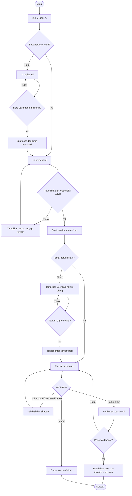

## AD-02 — Profil kesehatan dan BMI (UC-10–UC-13)

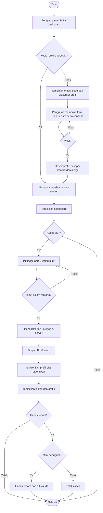

## AD-03 — Jurnal kesehatan (UC-14–UC-16)

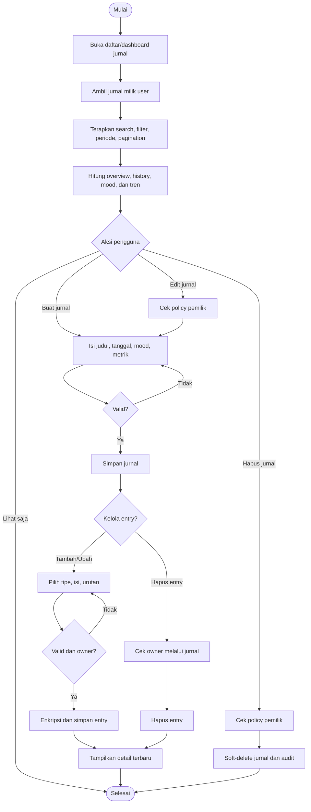

## AD-04 — Profil, dashboard, meal, dan item nutrisi (UC-17–UC-20)

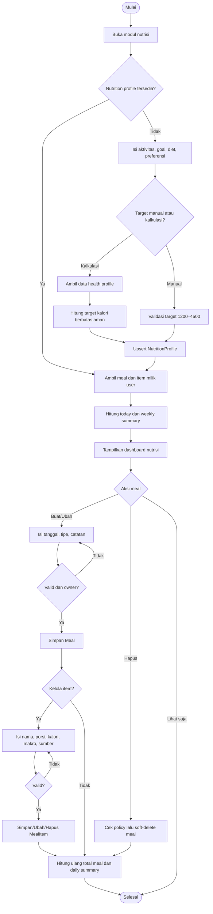

## AD-05 — Analisis foto makanan dan menu sehat (UC-21–UC-23)

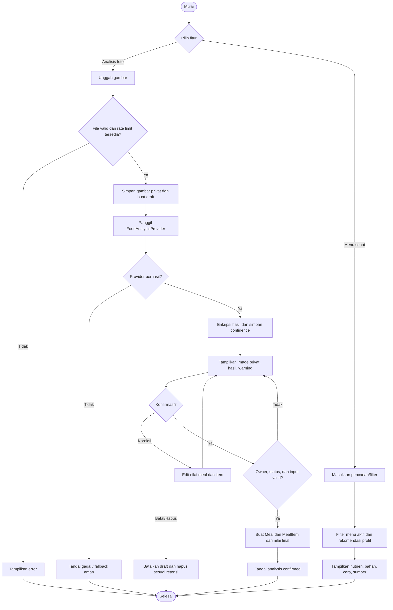

## AD-06 — Asisten kesehatan (UC-24–UC-25)

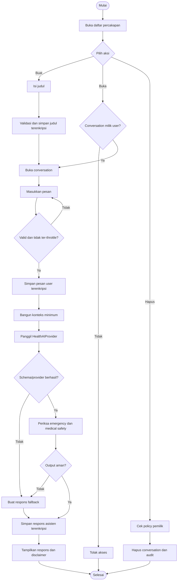

## AD-07 — Symptom checker dan simpan ke jurnal (UC-26–UC-28)

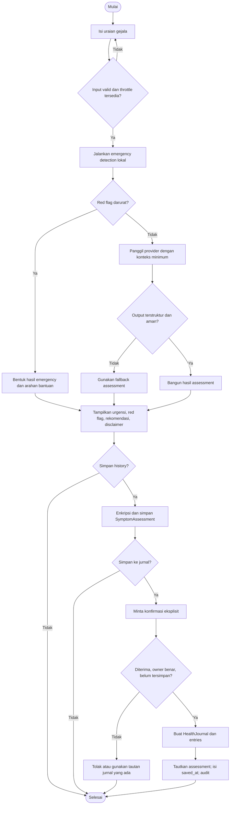

## AD-08 — Insight dan health goal (UC-29–UC-31)

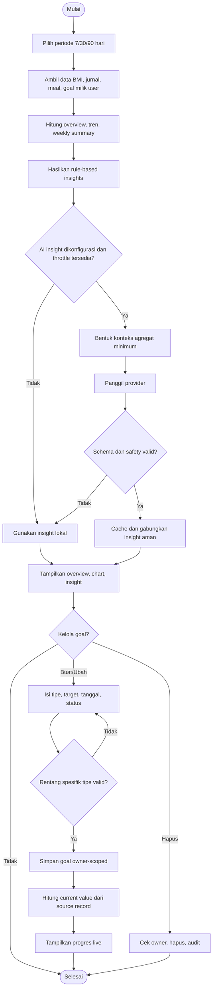

## AD-09 — Rencana kesehatan harian (UC-32–UC-33)

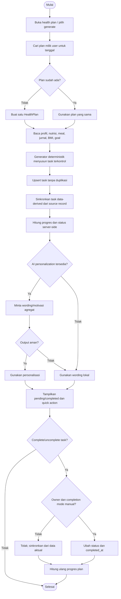

## AD-10 — Notifikasi, reminder, dan real-time (UC-34–UC-37)

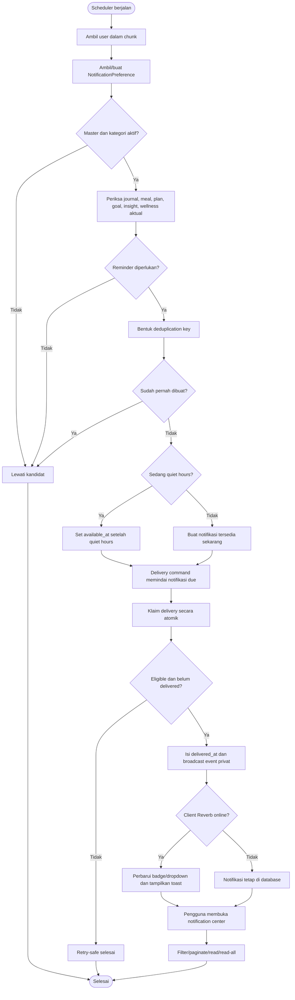

## AD-11 — Dashboard admin dan audit (UC-38–UC-39)

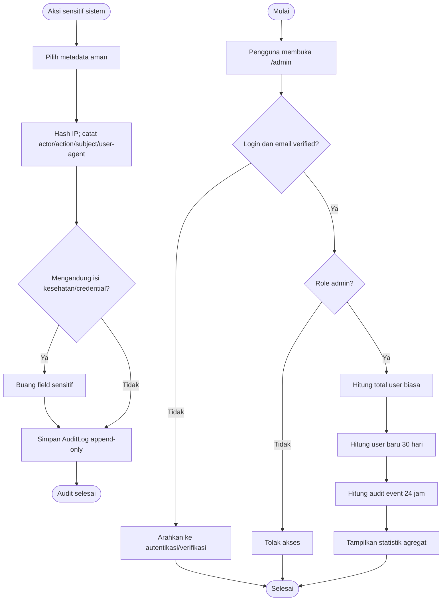

