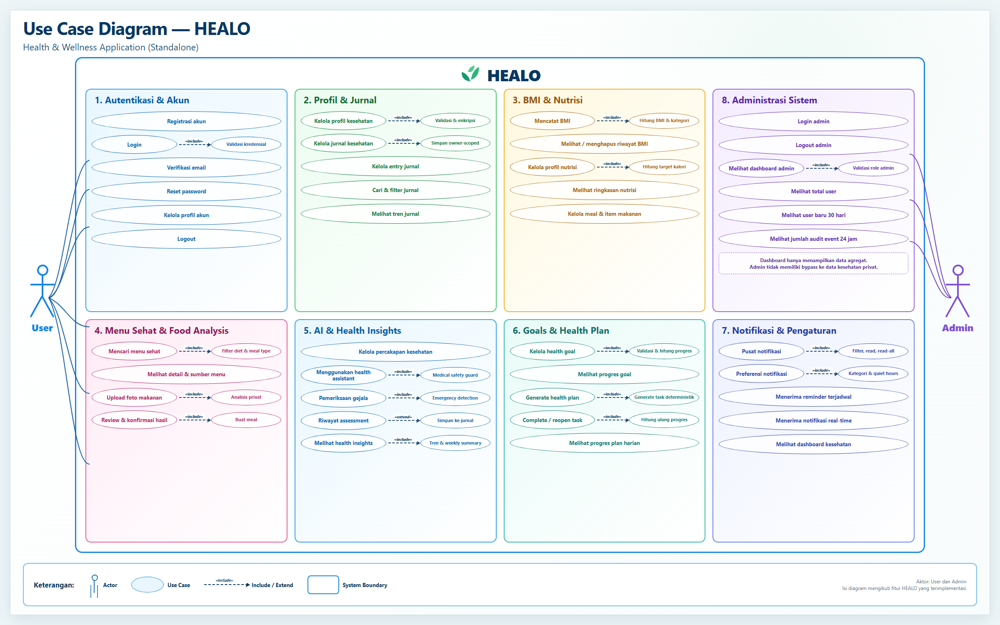
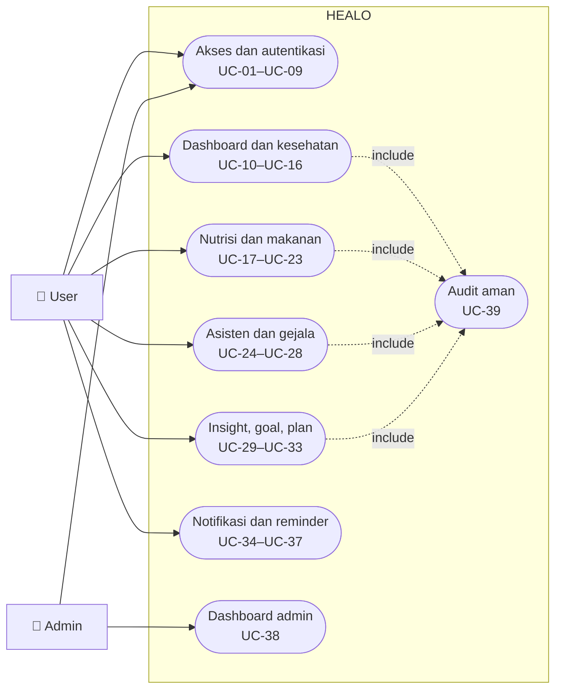
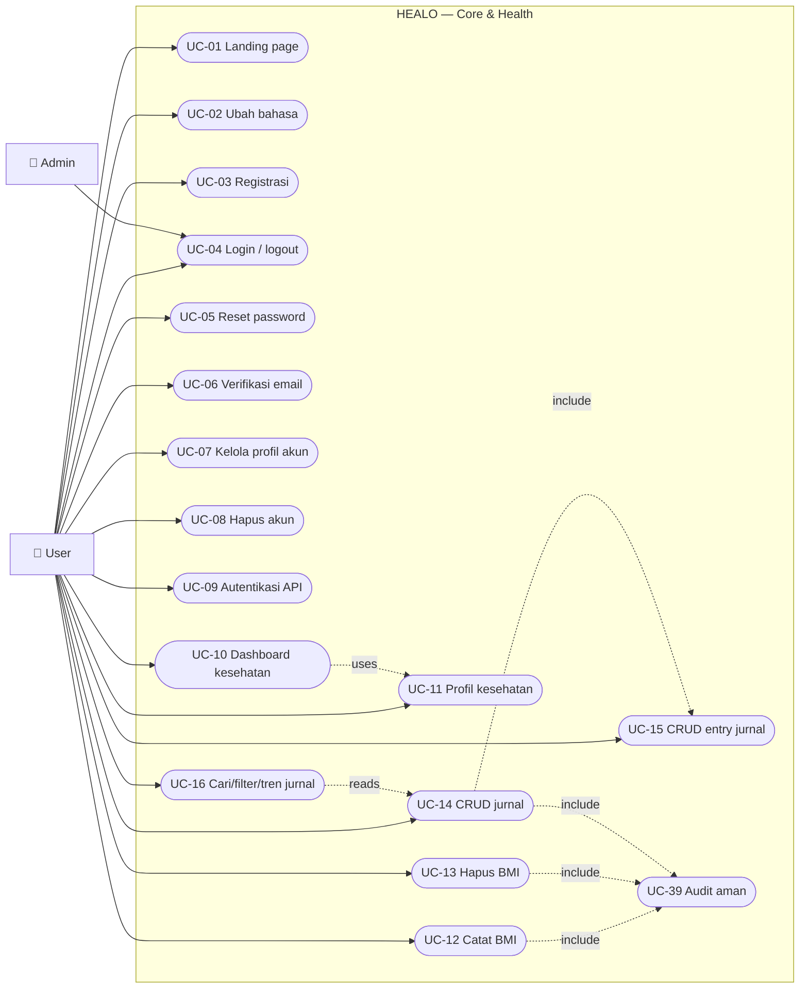
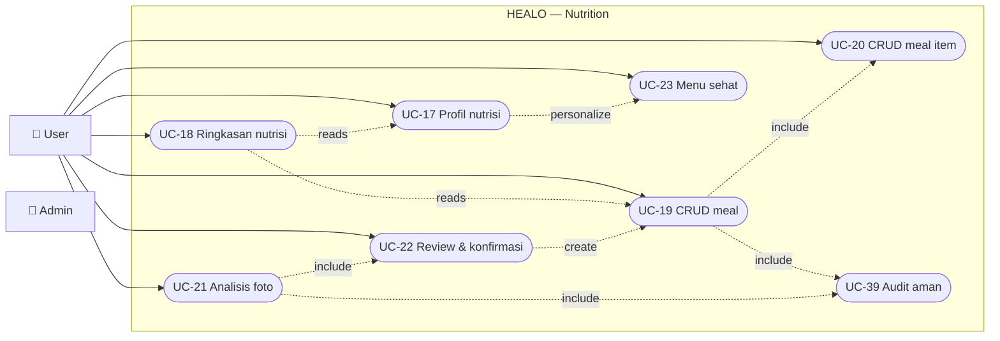
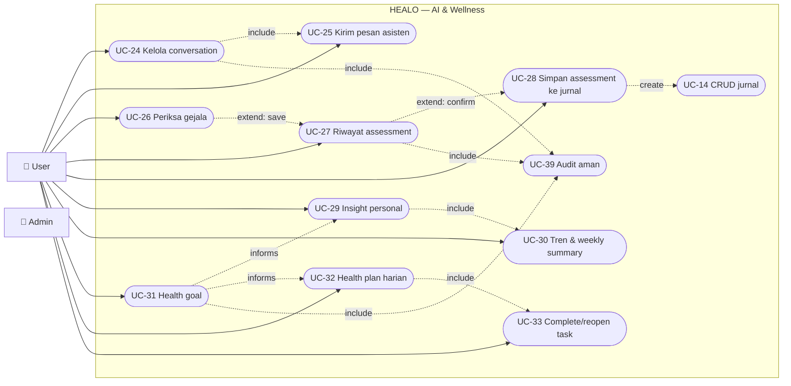
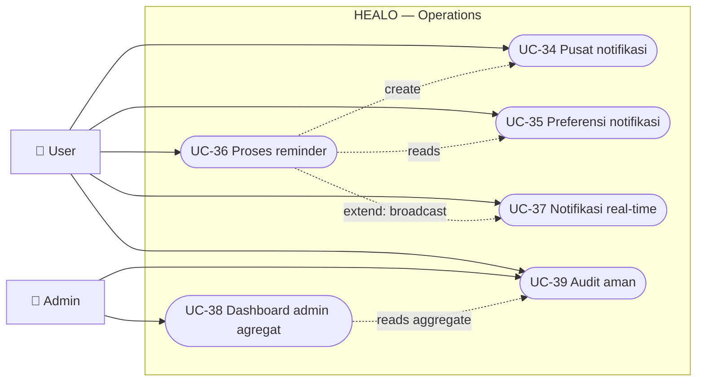
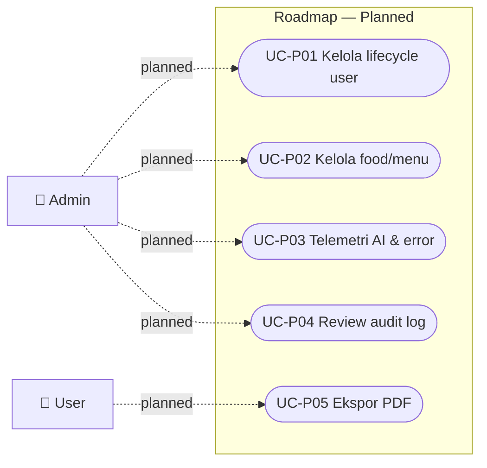

# Use Case Diagram

Versi poster visual bergaya UML tersedia dalam format [PNG](use-case-diagram-poster.png) dan [HTML yang dapat diedit](use-case-diagram-poster.html).

Seluruh diagram memakai tepat dua aktor bisnis: `User` dan `Admin`. Aktivitas sebelum autentikasi tetap menjadi tanggung jawab User. AI provider, API client, scheduler, queue worker, Reverb, dan komponen internal lain bukan aktor.

Mermaid belum memiliki notasi native UML use case. Karena itu, aktor digambar sebagai node persegi dan use case sebagai node oval/stadium; relasi `include` dan `extend` diberi label eksplisit.

Catatan autentikasi: route web kesehatan menggunakan `auth + verified`, sedangkan endpoint API v1 privat pada implementasi saat ini menggunakan `auth:sanctum + throttle`.

## UCD-01 — Gambaran umum sistem

## UCD-02 — Akses, kesehatan dasar, dan jurnal

## UCD-03 — Nutrisi dan analisis makanan

## UCD-04 — AI health, insight, goal, dan health plan

## UCD-05 — Notifikasi, reminder, dan administrasi

## UCD-06 — Batas fitur planned

Node berikut sengaja tidak dihubungkan ke sistem aktif karena route/surface penuh belum diimplementasikan.

