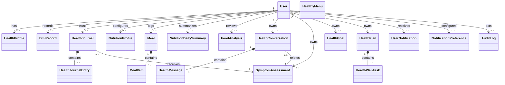
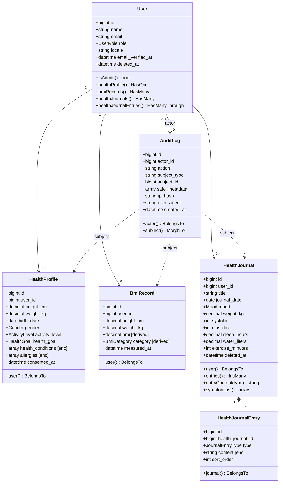
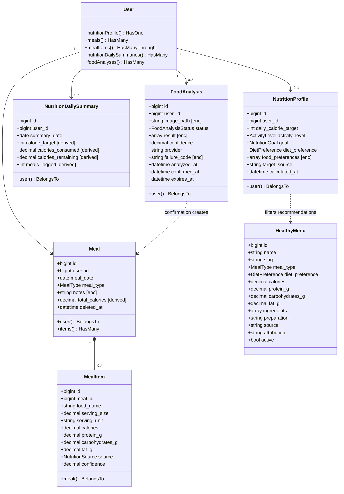
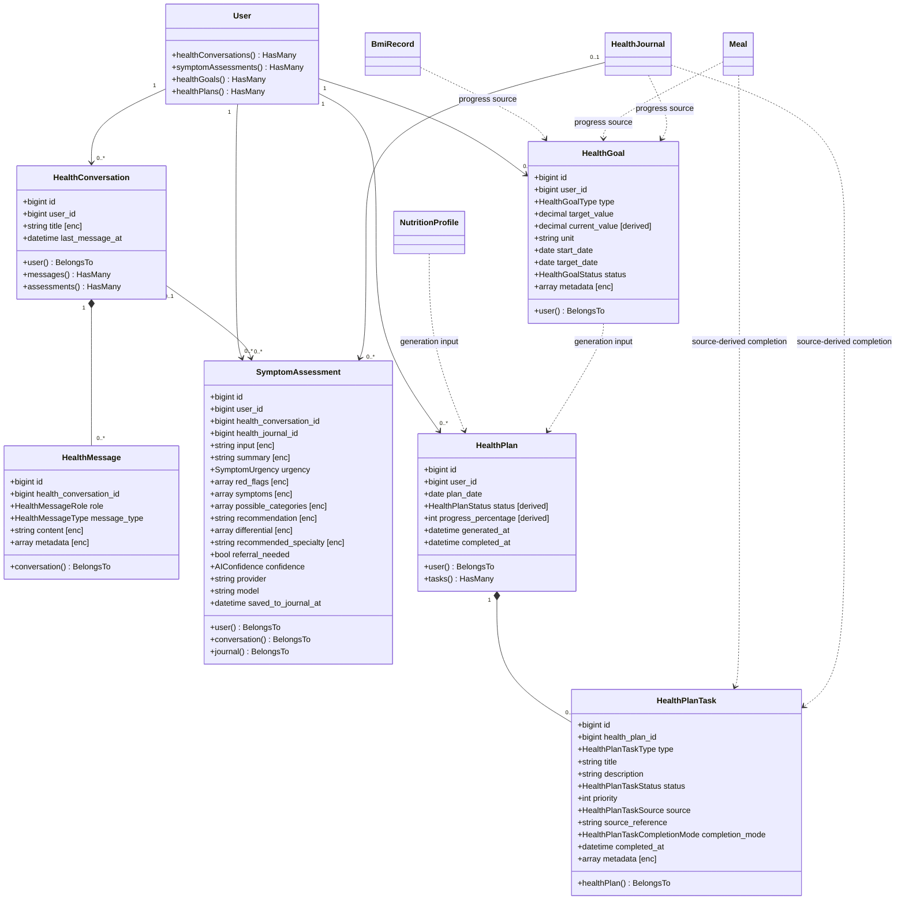
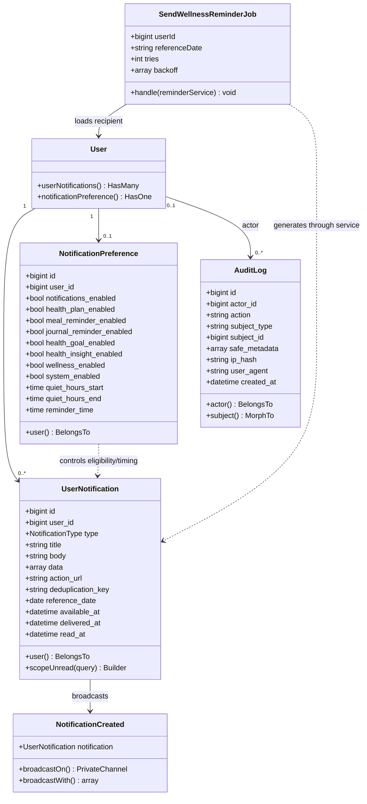
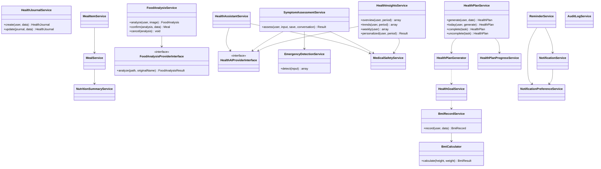

# Class Diagram

Diagram ini merepresentasikan class/model yang benar-benar ada pada aplikasi. Tabel yang hanya muncul sebagai rencana pada ERD lama (`foods`, `food_scans`, `food_logs`, `menus`, `ai_usage_logs`, dan sejenisnya) tidak dimasukkan karena tidak memiliki model/migration aktif saat analisis ini dibuat.

Notasi:

- `[enc]` = cast terenkripsi saat disimpan.
- `[derived]` = nilai dihitung/sinkronkan server dari source record.
- Kardinalitas memakai bentuk `1`, `0..1`, dan `0..*`.

## CD-01 — Peta model domain keseluruhan

## CD-02 — Core account, health profile, BMI, dan jurnal

## CD-03 — Nutrisi dan analisis makanan

## CD-04 — AI health, assessment, goal, dan health plan

## CD-05 — Notifikasi dan audit operasional

## CD-06 — Service layer dan dependensi utama

## Aturan integritas class/domain yang penting

| Aturan | Implementasi |
| --- | --- |
| Satu profil kesehatan per user | Relasi `User 1 — 0..1 HealthProfile` dan unique `user_id`. |
| Satu profil nutrisi/preferensi notifikasi per user | Relasi has-one dan unique `user_id`. |
| Satu health plan per user per tanggal | Unique gabungan `user_id + plan_date`; generator bersifat idempoten. |
| Total meal dan progress plan tidak dipercaya dari client | Nilai dihitung ulang oleh service. |
| Kepemilikan child record | `HealthJournalEntry` melalui jurnal, `MealItem` melalui meal, `HealthPlanTask` melalui plan. |
| Draf food analysis bukan meal | `FoodAnalysis` tidak memiliki FK langsung ke `Meal`; service baru membuat meal saat konfirmasi valid. |
| Assessment ke jurnal opsional | `health_journal_id` nullable dan hanya diisi setelah konfirmasi. |
| Notifikasi durable lebih utama dari real-time | Record `UserNotification` dibuat dahulu; event broadcast adalah efek tambahan. |
| Audit tidak menyimpan konten kesehatan | `safe_metadata` dibatasi; IP di-hash; subject menggunakan relasi polymorphic. |

