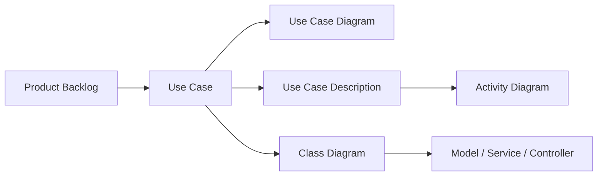

# Analisis Sistem HEALO

Dokumen ini memetakan implementasi aplikasi HEALO per 26 Oktober 2026. Sumber analisis utama adalah route web/API, controller, Form Request, policy, service, model, migration, test, dan `docs/implementation-roadmap.md`.

## Paket dokumen

1. [Pemetaan product backlog ke use case](01-product-backlog-use-case-map.md)
2. [Deskripsi use case](02-use-case-descriptions.md)
3. [Activity diagram](03-activity-diagrams.md)
4. [Use case diagram](04-use-case-diagrams.md)
5. [Class diagram](05-class-diagrams.md)

Poster activity diagram: [PNG siap pakai](activity-diagram-poster.png) · [HTML yang dapat diedit](activity-diagram-poster.html)

## Batasan dan konvensi

- Cakupan utama adalah fitur yang benar-benar memiliki route/implementasi saat ini, bukan seluruh ide pada roadmap.
- Fitur administrasi fase 8 selain dashboard agregat serta ekspor PDF fase 9 ditandai **planned** dan tidak digambar sebagai kemampuan aktif.
- Model use case memakai tepat dua aktor: `User` dan `Admin`. Aktivitas sebelum login, seperti registrasi dan reset password, tetap dimodelkan sebagai tindakan User.
- Komponen AI provider, scheduler, queue worker, API client, dan Reverb adalah sistem pendukung, bukan aktor bisnis.
- API v1 bukan use case bisnis terpisah apabila perilakunya sama dengan web; kolom kanal menunjukkan apakah use case tersedia melalui Web, API, atau keduanya.
- Semua record kesehatan pribadi bersifat owner-scoped. Peran admin tidak memperoleh bypass otomatis ke data kesehatan pribadi.
- Diagram menggunakan Mermaid agar dapat dirender oleh GitHub, GitLab, editor Markdown modern, atau Mermaid Live Editor.

## Ringkasan aktor

| Aktor | Tanggung jawab/interaksi |
| --- | --- |
| User | Mengakses landing/auth, lalu mengelola akun dan seluruh data kesehatan miliknya melalui Web atau API. |
| Admin | Login dan melihat dashboard agregat yang dilindungi role; tidak memperoleh akses khusus ke record kesehatan pribadi. |

Pada activity diagram, lane `Sistem HEALO` menunjukkan tanggung jawab aplikasi dan integrasi internal. Lane tersebut bukan aktor tambahan.

## Traceability singkat

Alur keterlacakan dokumentasi adalah:

